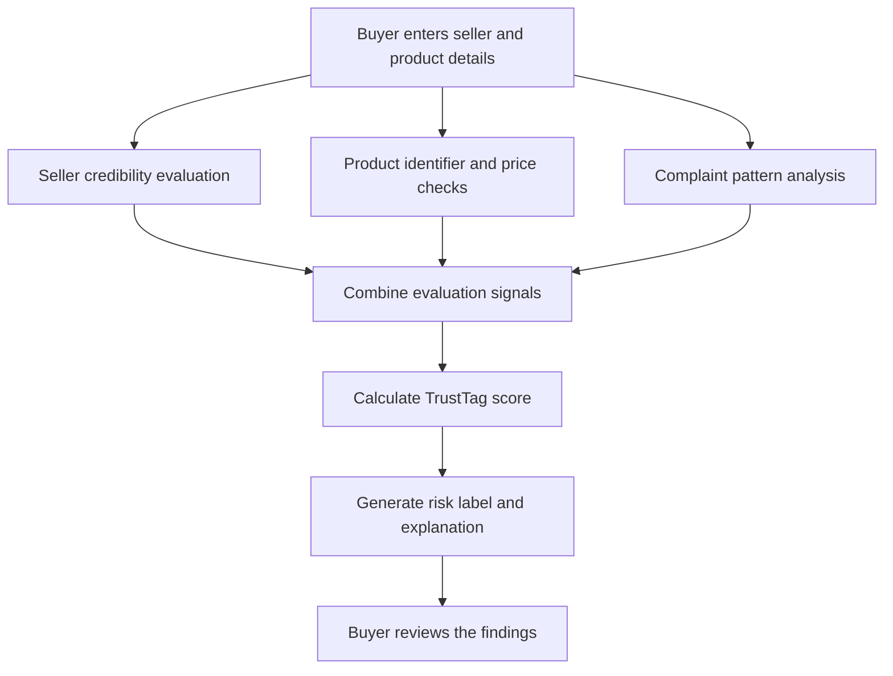

# 🛡️ TrustTag — Intelligent Anti-Counterfeit Trust Platform

> **Know Before You Pay. Report. Verify. Build Trust.**
>
> TrustTag is a prototype platform designed to help online electronics buyers assess seller credibility, identify potential counterfeit products, connect complaints to suspicious patterns, and support fairer dispute resolution.
> AI Chatbot - Claude AI
> AI Agent- Crew ai but later on it asks for payment so eventually shfted to Google AI studio

## 📌 Table of Contents

- [1. Project Overview](#-1-project-overview)
- [2. Problem Statement](#-2-problem-statement)
- [3. Why Do We Need TrustTag?](#-3-why-do-we-need-trusttag)
- [4. Our Proposed Solution](#-4-our-proposed-solution)
- [5. Key Features](#-5-key-features)
- [6. How TrustTag Works](#-6-how-trusttag-works)
- [7. Multi-Agent Architecture](#-7-multi-agent-architecture)
- [8. Technology Stack](#-8-technology-stack)
- [9. Project Structure](#-9-project-structure)
- [10. Installation and Setup](#-10-installation-and-setup)
- [11. Beginner's Guide to Using TrustTag](#-11-beginners-guide-to-using-trusttag)
- [12. Example Demonstration](#-12-example-demonstration)
- [13. Testing the Project](#-13-testing-the-project)
- [14. Current Limitations](#-14-current-limitations)
- [15. Future Enhancements](#-15-future-enhancements)
- [16. Project Impact](#-16-project-impact)

---

## 🔍 1. Project Overview

Online shopping makes electronic products accessible and affordable, but it can also expose buyers to counterfeit accessories, misleading product listings, unreliable sellers, and unresolved complaints.

**TrustTag aims to add a layer of trust between online buyers and electronics sellers.**

It evaluates available seller information, product identifiers, listed prices, packaging clues, and reported complaints to generate an explainable risk assessment. It also provides workflows for submitting complaints, evaluating seller verification applications, and viewing suspicious seller activity.

Unlike a system that considers every complaint separately, TrustTag is designed to connect related reports and help identify recurring patterns.

### Our vision

To make online electronics purchases more transparent by helping buyers make informed decisions before paying and helping legitimate sellers demonstrate their credibility.

## 🚨 2. Problem Statement

Consider this scenario:

A customer finds a branded electronic accessory at an unusually low price on an unfamiliar online store. The packaging looks almost identical to the original product, so the customer decides to buy it. Within a few days, the product stops working, and the seller becomes unreachable.

Meanwhile, other customers may be experiencing the same issue. However, their complaints remain disconnected, making it difficult to recognize a broader counterfeit or seller-abuse pattern.

This creates five major problems:

1. **Seller uncertainty:** Buyers cannot easily determine whether an unfamiliar seller is trustworthy.
2. **Product authenticity concerns:** Fake products can imitate genuine packaging and use misleading serial numbers.
3. **Suspicious pricing:** Extremely low prices can lure customers into purchasing counterfeit or unsafe products.
4. **Disconnected complaints:** Repeated product failures and suspicious seller behavior can remain unnoticed when reports are isolated.
5. **Lack of accountability:** Buyers may struggle to organize evidence, understand possible remedies, or obtain a meaningful response.

### Core problem statement

> Online electronics buyers lack an accessible, unified way to assess seller credibility and product authenticity before purchase. When products fail or turn out to be counterfeit, isolated complaints and limited accountability make suspicious patterns difficult to detect, leaving buyers vulnerable and legitimate sellers struggling to earn trust.

## 💡 3. Why Do We Need TrustTag?

TrustTag addresses the need for a more transparent and evidence-driven approach to online electronics transactions.

| Existing challenge | How TrustTag addresses it |
|---|---|
| Buyers have limited information about unfamiliar sellers | Generates a seller credibility assessment from available records |
| Fake products imitate genuine products | Checks product identifiers against the project's local demo registry and evaluates pricing and packaging clues |
| Suspiciously cheap products attract buyers | Flags prices that fall outside configured reference ranges |
| Complaints remain disconnected | Analyzes related seller, product, batch, and failure information |
| Dispute resolution can be confusing | Classifies reported problems and suggests possible next steps |
| Legitimate sellers struggle to establish trust | Provides a structured seller verification workflow and a demo verification badge |

### Why this approach matters

TrustTag focuses on **prevention as well as response**.

- **Before a purchase:** It helps buyers examine warning signs before committing money.
- **After a problem:** It helps organize a complaint and suggest a resolution.
- **Across multiple reports:** It helps identify recurring patterns that may indicate a larger issue.
- **For legitimate businesses:** It provides a structured way to submit credentials for evaluation.

The goal is not to declare every unfamiliar seller fraudulent. It is to make available evidence easier to evaluate and potential risks easier to understand.

## 🛡️ 4. Our Proposed Solution

TrustTag combines deterministic Python-based audit tools, a multi-agent architecture, a Streamlit interface, and an SQLite database.

The prototype organizes its functionality into four primary workflows:

**Flow A — Check Before You Pay**

Evaluates seller credibility, product identifiers, listed price, packaging information, and related complaint patterns. It returns a composite TrustTag score, a risk label, and explanatory findings.

**Flow B — Report a Problem**

Allows a buyer to submit details about a counterfeit product, early hardware failure, non-delivery, or another supported issue. The application records the complaint, classifies it using configured rules, and drafts suggested buyer and seller communications.

**Flow C — Seller Get Verified**

Allows a merchant to submit business and contact information for evaluation against the prototype's verification criteria. The application calculates a verification score and indicates whether the demo badge criteria are met.

**Flow D — Public Risk Board**

Presents seller-risk and complaint information to help users identify suspicious activity and recurring issues.

## ✨ 5. Key Features

### 🔎 Pre-purchase trust assessment
- Seller credibility evaluation.
- Product identifier checks against local demo records.
- Configured price-baseline comparisons.
- Packaging-related warning signals.
- Composite score with an explainable verdict.

### ⚠️ Complaint intelligence
- Complaint records stored in SQLite.
- Analysis of related sellers, product identifiers, and batch codes.
- Detection of configured rapid-failure complaint patterns.
- Risk penalties based on the project's rules.

### ⚖️ Dispute assistance
- Classification of supported complaint categories.
- Recommended actions based on available evidence and configured rules.
- Drafted communications for buyers and sellers.
- Case tracking through stored complaint and dispute records.

### 🏅 Seller verification
- Business registration information.
- Identity-document category.
- Contact email and customer-support telephone.
- Verification scoring and feedback.
- Demo verification badge when the configured criteria are satisfied.

### 📊 Risk visibility
- Seller and complaint information in a public-facing risk board.
- Signals intended to highlight recurring issues.
- A centralized view of information stored by the prototype.

### ⚡ Offline demo mode
- Uses local deterministic evaluation logic.
- Supports demonstrations without requiring an external AI API for the core audit workflow.
- Helps make results reproducible during a presentation.

**Important:** Offline mode is not proof that five independent AI agents have executed live. In the current implementation, the main trust score is calculated by deterministic Python functions, while agent-style logs explain the evaluation workflow.

## ⚙️ 6. How TrustTag Works

The following diagram illustrates the intended evaluation workflow.



### Step-by-step explanation

1. **Input collection:** The buyer enters details such as seller name, product serial or QR identifier, category, listed price, batch code, and packaging information where applicable.

2. **Seller evaluation:** The system examines available seller records and configured credibility indicators.

3. **Product evaluation:** The system checks the identifier against its local manufacturer demo data and evaluates the listed price and other available product clues.

4. **Complaint analysis:** The system examines related complaint records for suspicious clusters, including repeated failures associated with sellers or batches.

5. **Score calculation:** The Python scoring logic combines seller credibility, product authenticity signals, and complaint penalties.

6. **Risk classification:** The system assigns a result such as `VERIFIED`, `CAUTION`, or `HIGH_RISK` according to the configured rules.

7. **Explanation:** The interface presents the score, findings, warnings, and suggested buyer action.

8. **Follow-up workflows:** If a problem occurs, the buyer can submit a complaint. A merchant can also submit information through the seller verification workflow.

### Composite TrustTag score

The current scoring function uses the following formula:

```text
TrustTag Score =
    (Seller Credibility × 0.45)
  + (Product Authenticity × 0.45)
  - Complaint Cluster Penalty
```

The final score is rounded to an integer and bounded between 0 and 100.

The score uses seller credibility and product authenticity scores on a 0–100 scale, with a configured complaint penalty.

- **VERIFIED:** Score is at least 75, the product passes the configured safety checks, and there is no complaint-cluster penalty.
- **CAUTION:** The result does not qualify as verified, but the composite score is at least 50.
- **HIGH_RISK:** The composite score is below 50.

These are prototype rules, not an independent guarantee of product authenticity or safety.

## 🤖 7. Multi-Agent Architecture

TrustTag is organized around five agent roles.

| Agent | Responsibility |
|---|---|
| Seller Verification Agent | Evaluates seller credibility using available merchant records |
| Product Authenticity Agent | Examines product identifiers, price signals, and packaging clues |
| Complaint Intelligence Agent | Identifies relationships between complaints, sellers, and product batches |
| Dispute Resolution Agent | Classifies complaints and recommends possible remedies |
| Trust Score Agent | Combines evaluation results into a final score and explanation |

### How the roles fit together

The first three roles provide information about the seller, product, and complaint history. The dispute role supports complaint handling, while the final scoring role is intended to summarize the findings for the buyer.

The current implementation uses deterministic Python tools for the core score and rule-based dispute outcomes. The interface can display agent-style execution logs in offline demo mode. Live, independent LLM-based agent execution should only be claimed when that behavior is actually enabled and verified.

## 🧰 8. Technology Stack

| Technology | Purpose |
|---|---|
| Python | Core application logic and evaluation rules |
| Streamlit | Interactive web interface |
| SQLite | Local persistence for sellers, complaints, and disputes |
| CrewAI | Multi-agent framework and agent definitions |
| Pydantic | Data validation support |
| Pandas | Data processing support |
| Altair | Visualization support |
| JSON | Seed data for the demonstration dataset |
| Git and GitHub | Source control and project collaboration |

## 📁 9. Project Structure

```text
trusttag/
│
├── app.py              # Main Streamlit interface and user workflows
├── agents.py           # Agent definitions and workflow runners
├── tasks.py            # CrewAI task specifications
├── tools.py            # Scoring, product checks, complaint analysis and rules
├── database.py         # SQLite schema, initialization and database helpers
├── seed_data.json      # Sample seller, product and complaint data
├── requirements.txt    # Python package dependencies
├── .env.example        # Example environment configuration, if included
├── .gitignore          # Files that should not be committed
└── README.md           # Project documentation
```

The database file is initialized by the application. Additional files may exist in the repository depending on the current version.

## 🚀 10. Installation and Setup

Follow these steps even if you are new to Python or VS Code.

### Prerequisites

Install the following:

- Python 3.10 or later.
- Visual Studio Code.
- Git, if you want to clone the repository or contribute changes.
- A terminal such as PowerShell on Windows.

### Step 1 — Get the project

If you already have the project folder, open it in VS Code using **File → Open Folder**.

If you are cloning from GitHub, run:

```bash
git clone <YOUR_GITHUB_REPOSITORY_URL>
cd trusttag
```

Replace the placeholder with your actual repository URL.

### Step 2 — Open a terminal

In VS Code, choose:

**Terminal → New Terminal**

Make sure the terminal is in the TrustTag project directory, where `app.py` and `requirements.txt` are located.

### Step 3 — Create a virtual environment

On Windows PowerShell:

```powershell
python -m venv venv
```

Activate it:

```powershell
.\venv\Scripts\Activate.ps1
```

If PowerShell blocks activation, Command Prompt can use:

```bat
venv\Scripts\activate.bat
```

On macOS or Linux:

```bash
python3 -m venv venv
source venv/bin/activate
```

### Step 4 — Install dependencies

With the virtual environment activated, run:

```bash
python -m pip install --upgrade pip
python -m pip install -r requirements.txt
```

Wait until installation finishes.

### Step 5 — Start TrustTag

Run:

```bash
python -m streamlit run app.py
```

Using `python -m streamlit` helps ensure Streamlit runs through the Python interpreter associated with the active environment.

### Step 6 — Open the application

Streamlit normally prints a local URL in the terminal:

```text
http://localhost:8501
```

Open that address in your browser.

Keep the terminal running while you use the application. To stop the server, press `Ctrl + C` in that terminal.

### Do I need an API key?

The core deterministic offline demo is designed to work without an external LLM API key. Additional credentials may be required if optional live AI functionality is configured in a particular version of the project.

Never commit API keys or passwords to GitHub.

## 🧑‍💻 11. Beginner's Guide to Using TrustTag

### Flow A — Check Before You Pay

1. Open the application and select **Flow A: Check Before You Pay** from the sidebar.
2. Choose one of the available demonstration presets, or enter custom details.
3. Provide the seller name, product identifier, category, listed price, and other requested information.
4. Run the trust audit.
5. Review the score, badge, seller findings, product findings, and complaint warnings.
6. Compare the result against the evidence shown by the application.

Start with the honest merchant preset, then run the suspicious clone preset to compare the results.

### Flow B — Report a Problem

1. Select **Flow B: Report a Problem**.
2. Enter the requested buyer, seller, product, and purchase information.
3. Select the problem category and describe what happened.
4. Submit the complaint.
5. Review the generated case ID, classification, recommended action, and drafted communications.
6. Open the risk board to see how complaint records contribute to the application's risk information.

Use fictional demonstration data rather than real personal information when testing.

### Flow C — Seller Get Verified

1. Select **Flow C: Seller 'Get Verified'**.
2. Enter the sample business details and requested contact information.
3. Submit the verification application.
4. Review the verification score, feedback, and badge result.
5. Try different sample inputs to understand how the configured criteria affect the result.

The prototype evaluates submitted information against local rules; it does not establish that a real government identity or business registration has been independently authenticated.

### Flow D — Public Risk Board

1. Select **Flow D: Public Risk Board**.
2. Review the seller-risk information and complaint-related alerts available in the database.
3. Identify repeated reports or suspicious patterns.
4. Return to the pre-purchase workflow and see how these signals can influence a later assessment.

### CrewAI Architecture & Logs

Open the architecture and logs section to inspect the agent roles and the evaluation trace displayed by the current application.

In offline demo mode, treat these as explanations of the deterministic workflow, not proof of live LLM calls.

## 🎯 12. Example Demonstration

TrustTag includes sample scenarios intended to demonstrate contrasting outcomes.

### Scenario A — Honest merchant

- **Sample seller:** Apex Electro Direct
- **Sample product:** Anker-style 65W charger
- **Sample listed price:** $54.99
- **Expected demo score:** 90/100
- **Expected demo badge:** `VERIFIED`

This example demonstrates how favorable seller records and product checks can produce a higher trust score.

### Scenario B — Suspicious clone seller

- **Sample seller:** MegaDiscount Deals Hub
- **Sample product:** Charger with a suspicious clone identifier
- **Sample listed price:** $7.99
- **Expected demo score:** 0/100
- **Expected demo badge:** `HIGH_RISK`

This example demonstrates how a suspicious identifier, a very low price, and complaint-risk signals can produce a high-risk result.

These are outcomes from the project's sample data and configured evaluation rules. They are not live findings about real businesses or products.

## 🧪 13. Testing the Project

Before presenting TrustTag, check each workflow.

- [ ] The virtual environment activates successfully.
- [ ] Dependencies install without errors.
- [ ] The Streamlit application starts.
- [ ] The honest merchant preset produces the expected sample result.
- [ ] The suspicious clone preset produces the expected sample result.
- [ ] A complaint can be submitted and a case ID is displayed.
- [ ] The seller verification workflow returns a result.
- [ ] The risk board loads its available data.
- [ ] Saved records behave as expected after restarting the application.
- [ ] The application can be opened from another device if network sharing is configured.

The scoring examples have been checked against the project's evaluation functions. Full end-to-end testing of every UI flow and any optional live-agent configuration should be completed in the target environment.

## ⚠️ 14. Current Limitations

TrustTag is a hackathon/demo prototype, not a production-grade anti-counterfeit certification service.

- **Local demo registry:** Product identifier checks use the project's available records. The application does not automatically query every manufacturer's official database.
- **Rule-based assessment:** Scores and classifications depend on configured rules and the quality of the available data.
- **Sample dataset:** Demonstration sellers, products, and complaints should not be interpreted as verified real-world reports.
- **Seller verification:** A score or badge does not independently prove that a real business or identity document is genuine.
- **Dispute assistance:** Generated recommendations and draft notices are suggestions, not binding legal decisions or guarantees of refunds.
- **Live AI execution:** Offline agent logs do not establish that live LLM agents were independently executed.
- **Security and scale:** Authentication, production-grade access control, abuse prevention, privacy protections, and deployment hardening require additional work.

A TrustTag result should be treated as a risk signal to support a buyer's decision, not as a guarantee that a product is genuine or safe.

## 🚀 15. Future Enhancements

Potential next steps include:

1. **Manufacturer API integration:** Connect to authorized product registries for stronger authenticity checks.
2. **QR and NFC verification:** Introduce secure identifiers that are harder to copy or reuse.
3. **Improved complaint clustering:** Add more robust pattern detection across product batches, sellers, and time windows.
4. **Verified evidence workflow:** Support structured evidence collection and review.
5. **Marketplace integration:** Explore authorized reporting and listing-review workflows with e-commerce platforms.
6. **Secure dispute tracking:** Add case updates, notifications, and transparent status histories.
7. **Production authentication:** Introduce appropriate user accounts, permissions, and audit trails.
8. **Live multi-agent evaluation:** Validate agent orchestration, model outputs, error handling, and reproducibility.
9. **Deployment and monitoring:** Host the service reliably and add monitoring, logging, and automated tests.

These are future development ideas, not claims about functionality already implemented.

## 🌍 16. Project Impact

TrustTag explores how software-based risk assessment and connected complaint information could make online electronics transactions more transparent.

Its intended benefits are:

- Helping buyers recognize warning signs before purchasing.
- Making suspicious complaint patterns easier to identify.
- Organizing buyer complaints and suggested next steps.
- Giving legitimate sellers a structured way to present their information.
- Encouraging decisions based on multiple signals rather than price or appearance alone.

### Final thought

> **Trust should not be a guessing game. TrustTag aims to turn scattered information into understandable signals, helping buyers make more informed decisions before they pay.**

---

**Project:** TrustTag — Anti-Counterfeit Trust Platform  
**Interface:** Streamlit  
**Core language:** Python  
**Data storage:** SQLite  
**Architecture:** Multi-agent design with deterministic evaluation tools

Built as a hackathon prototype to explore practical approaches to counterfeit-risk assessment, complaint intelligence, and digital trust.
